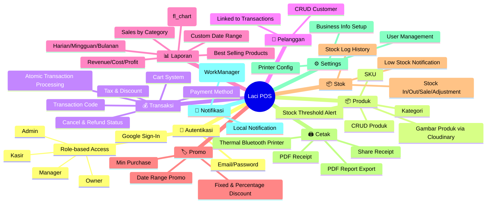

# 🔍 Analisis Proyek Laci POS — Roadmap Menuju Produk Siap Pasar

## Status Proyek Saat Ini

### Arsitektur & Tech Stack

| Aspek | Detail | Penilaian |
|-------|--------|-----------|
| **Arsitektur** | Clean Architecture (Domain → Data → Presentation) | ✅ Sangat baik |
| **State Management** | BLoC/Cubit dengan Equatable | ✅ Scalable |
| **DI** | GetIt + Injectable | ✅ Proper |
| **Backend** | Firebase (Auth, Firestore, Storage) | ⚠️ Perlu offline support |
| **Multi-tenant** | businessId scoping di semua entity | ✅ Sudah ready |
| **Error Handling** | Dartz Either pattern | ✅ Functional style |

> [!TIP]
> Arsitektur Clean Architecture yang sudah diterapkan adalah fondasi yang **sangat kuat** untuk scaling. Ini jauh lebih baik dari kebanyakan project POS indie.

---

### Audit Fitur yang Sudah Ada



### Domain Entities (8 Entity)

| Entity | Fields | Multi-tenant | Status |
|--------|--------|:------------:|--------|
| `UserEntity` | id, email, name, role, businessId | ✅ | Solid |
| `Product` | id, name, price, costPrice, stock, SKU, image | ✅ | Solid |
| `TransactionEntity` | full transaction with items, tax, discount | ✅ | Solid |
| `TransactionItem` | productId, quantity, price, costPrice, discount | ✅ | Solid |
| `Customer` | id, name, phone, address | ✅ | **Minimal** |
| `CategoryEntity` | Basic category | ✅ | Solid |
| `PromoEntity` | fixed/percentage, date range, min purchase | ✅ | Solid |
| `StockLog` | stockIn/Out/Sale/Adjustment with history | ✅ | Solid |
| `BusinessInfo` | name, address, phone, logo, QRIS | ✅ | Solid |

---

## ⚠️ Gap Analysis: Yang Kurang untuk Siap Pasar

Berdasarkan standar pasar Indonesia (Moka POS, Pawoon, Majoo, iReap), berikut gap-gap kritis:

### 🔴 Critical Gaps (Harus Ada)

| # | Fitur | Alasan | Effort |
|---|-------|--------|--------|
| 1 | **Offline Mode** | UMKM sering di lokasi tanpa internet stabil. Tanpa ini, app tidak bisa dipakai di lapangan | 🔥 Tinggi |
| 2 | **Barcode/QR Scanner** | 90% POS modern wajib support scan barcode. Product lookup harus bisa via kamera | 🟡 Sedang |
| 3 | **Multi-Payment Method** | Hanya string `paymentMethod`. Perlu: Cash, QRIS, Debit, Transfer, Split Payment | 🟡 Sedang |
| 4 | **Open/Close Kasir (Shift Management)** | Kasir perlu buka/tutup shift, hitung uang awal, dan rekonsiliasi akhir | 🟡 Sedang |
| 5 | **Pencarian Produk Real-time** | Di halaman kasir perlu search cepat by nama/SKU/barcode | 🟢 Rendah |
| 6 | **Sync Indicator** | User perlu tahu status sinkronisasi data (online/offline/syncing) | 🟢 Rendah |

### 🟡 Important Gaps (Sangat Direkomendasikan)

| # | Fitur | Alasan | Effort |
|---|-------|--------|--------|
| 7 | **Hutang/Piutang (Debt Tracking)** | Sangat umum di UMKM Indonesia: "bayar nanti" | 🟡 Sedang |
| 8 | **Multi-Unit Produk** | Produk bisa dijual per pcs, lusin, karton, dengan konversi stok otomatis | 🟡 Sedang |
| 9 | **Varian Produk** | Ukuran, warna, rasa — sangat penting untuk F&B dan retail | 🟡 Sedang |
| 10 | **Diskon Per-Item** | Saat ini diskon hanya di level transaksi, bukan per produk | 🟢 Rendah |
| 11 | **Riwayat Pelanggan** | Total belanja, transaksi terakhir, point loyalitas | 🟡 Sedang |
| 12 | **Dashboard Widget** | Homepage hanya placeholder. Perlu: penjualan hari ini, chart mini, shortcut | 🟡 Sedang |

### 🟢 Nice-to-Have (Differentiator)

| # | Fitur | Dampak Bisnis |
|---|-------|---------------|
| 13 | **Multi-Outlet** | Satu akun owner bisa manage banyak toko |
| 14 | **Loyalty Program** | Point system untuk repeat customer |
| 15 | **WhatsApp Integration** | Kirim struk via WhatsApp (sangat populer di Indonesia) |
| 16 | **Expense Tracking** | Catat pengeluaran toko (sewa, gaji, listrik) |
| 17 | **Supplier Management** | Kelola supplier dan purchase order |
| 18 | **Auto-Reorder Alert** | Notifikasi otomatis untuk restock ke supplier |
| 19 | **Table Management** | Untuk restoran: pilih meja, open bill |
| 20 | **Kitchen Display System (KDS)** | Untuk F&B: order langsung ke dapur |

---

## 🏗️ Masalah Teknis yang Perlu Diperbaiki

### 1. Homepage Masih Placeholder
```
// home_page.dart line 44
onPressed: () {
  // Navigate to POS/Checkout page when implemented  ← PLACEHOLDER
},
```
Transaksi terbaru juga masih hard-coded "Belum ada transaksi hari ini".

### 2. Tidak Ada Offline Strategy
Semua operasi langsung ke Firestore. Jika offline:
- Transaksi gagal ❌
- Data produk tidak tampil ❌
- Customer tidak bisa diakses ❌

> [!WARNING]
> Ini adalah **showstopper** terbesar. POS yang tidak bisa jalan tanpa internet **tidak layak pakai** di pasar Indonesia.

### 3. Report Service Performance
```dart
// report_service.dart — N+1 query problem
for (var doc in snapshot.docs) {
  final itemsSnapshot = await doc.reference
      .collection(FirebaseCollections.transactionItems).get();  // ← Query di dalam loop!
}
```
Ini akan sangat lambat saat data transaksi banyak. Perlu denormalisasi atau batch fetch.

### 4. Customer Entity Terlalu Sederhana
Hanya `name, phone, address`. Untuk pasar perlu: `email`, `totalPurchases`, `lastVisit`, `points`, `debt`.

### 5. Tidak Ada Data Validation Layer
Tidak ada validasi input di domain layer. Semua validasi di UI saja yang rentan bypass.

---

## 📊 Perbandingan dengan Kompetitor

| Fitur | Laci POS | Moka POS | Pawoon | iReap |
|-------|:--------:|:--------:|:------:|:-----:|
| Multi-platform | ✅ Flutter | ✅ | ✅ | ✅ |
| Offline Mode | ❌ | ✅ | ✅ | ✅ |
| Barcode Scan | ❌ | ✅ | ✅ | ✅ |
| Multi-Payment | ⚠️ Basic | ✅ | ✅ | ✅ |
| Shift Management | ❌ | ✅ | ✅ | ✅ |
| Inventory | ✅ Good | ✅ | ✅ | ✅ |
| Reports | ✅ Good | ✅ | ✅ | ✅ |
| Multi-Outlet | ❌ | ✅ | ✅ | ❌ |
| Hutang/Piutang | ❌ | ✅ | ❌ | ✅ |
| CRM/Loyalty | ❌ | ✅ | ✅ | ❌ |
| Thermal Print | ✅ | ✅ | ✅ | ✅ |
| Role Management | ✅ | ✅ | ✅ | ✅ |
| Free Tier | ✅ | ❌ | ⚠️ | ✅ |

> [!IMPORTANT]
> **Competitive advantage Laci POS:** Free/open-source + Firebase backend (mudah deploy) + Clean Architecture (mudah customize). Ini bisa jadi selling point untuk UMKM yang butuh POS murah tapi powerful.

---

## 🗺️ Roadmap Pengembangan (Prioritas)

### Phase 1: Stabilitas Inti (2-3 Minggu)
> Fokus: Buat core POS flow benar-benar production-ready

- [ ] **Fix Homepage** — Tampilkan penjualan hari ini, chart mini, recent transactions real-time
- [ ] **Barcode Scanner** — Integrasi `mobile_scanner` untuk scan produk di kasir
- [ ] **Improved Search** — Real-time search di kasir by nama/SKU/barcode
- [ ] **Multi-Payment** — Refactor `paymentMethod` dari String → structured model (Cash, QRIS, Debit, Transfer)
- [ ] **Split Payment** — Customer bayar sebagian cash, sebagian QRIS
- [ ] **Fix N+1 Query** — Denormalisasi transaction items ke dalam transaction document
- [ ] **Input Validation** — Tambah domain-level validation (ValueObject pattern)

### Phase 2: Fitur Wajib Pasar (3-4 Minggu)
> Fokus: Fitur yang membuat user UMKM mau pakai

- [✅] **Offline Mode** — Implementasi local database (Hive/Isar) + sync queue
- [ ] **Shift/Kasir Session** — Buka/tutup kasir, initial cash, end-of-day reconciliation
- [ ] **Hutang/Piutang** — `PaymentStatus.partial` sudah ada, tinggal build fitur debt tracking
- [ ] **Product Variants** — Size/color/flavor support dengan stock per-variant
- [✅] **Enhanced Customer** — Tambah purchase history, total spend, last visit
- [ ] **WhatsApp Share Receipt** — Kirim struk via WhatsApp (url_launcher)
- [✅] **Sync Status Indicator** — UI indicator: 🟢 Online | 🟡 Syncing | 🔴 Offline

### Phase 3: Differentiator (3-4 Minggu)
> Fokus: Fitur yang membedakan dari kompetitor

- [ ] **Multi-Unit** — Satuan produk (pcs, lusin, karton) dengan konversi stok
- [ ] **Loyalty Program** — Point system, reward tracking
- [ ] **Expense Tracking** — Pencatatan pengeluaran (sewa, gaji, dll)
- [ ] **Supplier Management** — Data supplier + purchase order
- [ ] **Advanced Reports** — Profit margin per produk, trend analysis, export Excel
- [ ] **Multi-Outlet** — Support banyak cabang dalam satu akun owner

### Phase 4: Spesialisasi Industri (2-3 Minggu)
> Fokus: Pilih satu vertikal untuk deep-dive

- [ ] **F&B Mode** — Table management, kitchen display, open bill
- [ ] **Retail Mode** — Bulk import produk, purchase order, minimum stock auto-reorder
- [ ] **Service Mode** — Untuk salon/laundry: booking, antrian, tracking service

---

## 💡 Rekomendasi Strategis

### 1. Target Market yang Disarankan
Fokus ke **UMKM F&B dan Retail kecil** di Indonesia karena:
- Volume pasar terbesar
- Toleransi UI sederhana tinggi
- Butuh solusi murah (free tier Laci POS = advantage)
- Fitur hutang/piutang sangat dibutuhkan

### 2. Monetization Model
| Tier | Harga | Fitur |
|------|-------|-------|
| **Free** | Rp 0 | 1 outlet, 100 produk, 1 kasir, basic reports |
| **Pro** | Rp 99K/bln | Unlimited produk, 5 kasir, advanced reports, WhatsApp receipt |
| **Business** | Rp 249K/bln | Multi-outlet, loyalty program, API access, priority support |

### 3. Quick Wins (Bisa Dikerjakan Sekarang)
1. ✅ Fix homepage → tampilkan data real
2. ✅ Tambah barcode scanner (1-2 hari)
3. ✅ Refactor payment method (1 hari)
4. ✅ WhatsApp share receipt (0.5 hari)
5. ✅ Search produk di kasir (0.5 hari)

### 4. Tech Debt yang Harus Dibayar
- [ ] Tambah unit tests (saat ini hanya boilerplate di `/test`)
- [ ] Tambah integration tests untuk transaction flow
- [ ] Implementasi proper error logging (Crashlytics/Sentry)
- [ ] Tambah CI/CD pipeline
- [ ] Tambah Firebase Security Rules yang proper

---

## Kesimpulan

> [!NOTE]
> **Laci POS sudah memiliki fondasi arsitektur yang kuat** (Clean Architecture + BLoC + Firebase multi-tenant). Yang dibutuhkan bukan rewrite, tapi **penambahan fitur kritikal** dan **perbaikan stabilitas** agar siap pasar.

**3 prioritas utama untuk launch:**
1. 🔴 **Offline Mode** — Tanpa ini, produk tidak viable di pasar Indonesia
2. 🟡 **Barcode + Improved Kasir UX** — Kecepatan kasir = kecepatan bisnis user
3. 🟡 **Shift Management + Hutang** — Fitur yang paling sering diminta UMKM

Dengan roadmap Phase 1 & 2 (± 6-7 minggu), Laci POS bisa menjadi **MVP yang layak launch** ke early adopters.
